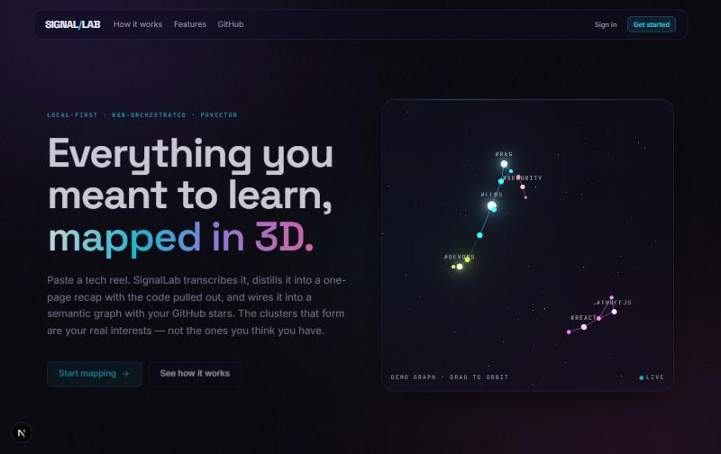
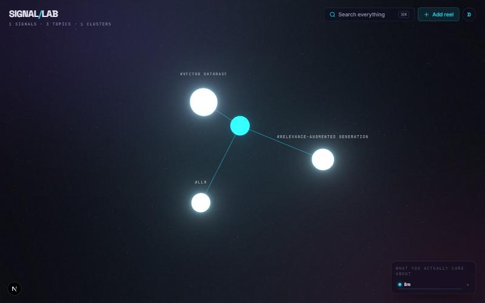
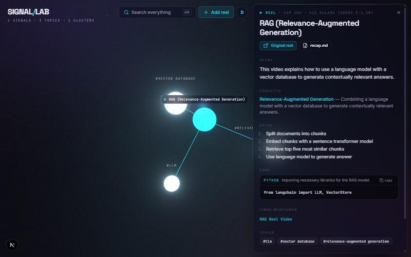
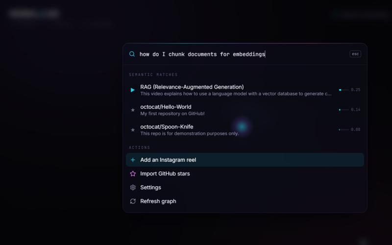
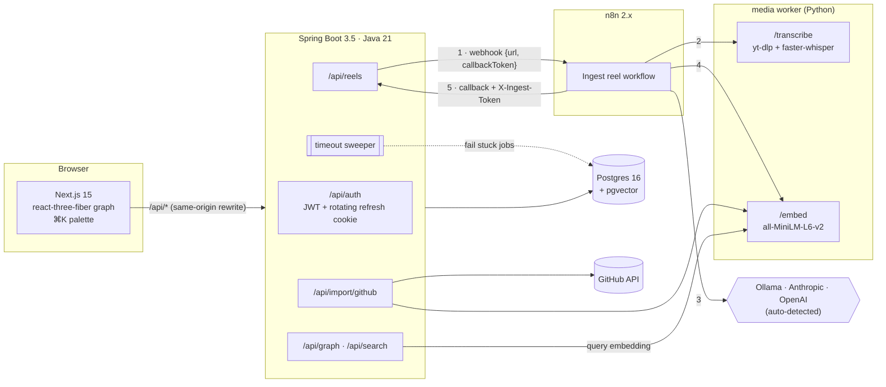
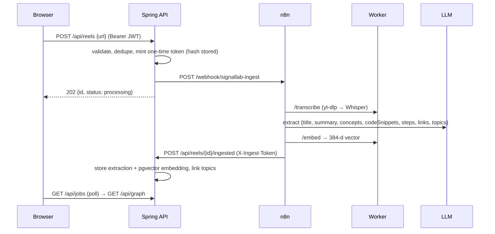

# SignalLab

> **A 3D map of everything you've ever meant to learn — searchable, runnable, and honest about what you actually care about.**

[](https://github.com/NikhilHolagunda/signallab/actions/workflows/ci.yml)

Paste an Instagram tech reel. An **n8n** workflow downloads it, transcribes it with **Whisper**, has a **local LLM** (Ollama) pull out concepts, steps, links and code, and embeds the result. A **Spring Boot** API stores it per-user in **Postgres + pgvector**, links it to similar reels, your **GitHub stars**, and topic hubs — and a **Next.js + Three.js** app renders the whole thing as a 3D force-directed knowledge graph whose clusters show what you actually keep coming back to.

| | |
|---|---|
|  |  |
|  |  |

<!-- TODO: demo GIF — add reel → n8n job ticker → node appears → click → recap -->
> 🎬 _Demo GIF coming soon._ Screenshots above are from a real local run (the recap was produced by a 1.5B test model; the default `llama3.1:8b` writes much richer notes).

---

## Run it in 3 commands

Prereqs: **Docker** (Compose v2.24+). Optional: **[Ollama](https://ollama.com/download)** on the host for local LLM extraction.

```bash
cp .env.example .env           # then set JWT_SECRET (e.g. `openssl rand -base64 48`)
ollama pull llama3.1:8b        # optional — without it you get cloud keys (if set) or a heuristic fallback
docker compose up -d --build
```

Open **http://localhost:3000**, create an account, and add a reel.

| | |
|---|---|
| App | http://localhost:3000 |
| API docs (Swagger) | http://localhost:8080/swagger-ui.html |
| n8n editor | http://localhost:5678 (create an owner account on first visit) |

> **Instagram needs a session.** Most reels require login for yt-dlp. Export your browser's cookies to `infra/secrets/cookies.txt` and set `YTDLP_COOKIES_FILE=/secrets/cookies.txt` in `.env`. Otherwise reels fail with a clear "set cookies" message and a retry button.
>
> First ingest is slow: the worker downloads Whisper `small` (~460 MB) and MiniLM (~90 MB) once.

## Architecture





### Repo layout

```
backend/    Spring Boot API (Gradle, Java 21)      → backend/src/main/java/dev/signallab
frontend/   Next.js 15 app                         → frontend/README.md
n8n/        workflows/ingest-reel.json + python-nodes/ (media worker)   → n8n/README.md
infra/      docker-compose.yml, Dockerfiles, n8n entrypoint, DB init     → infra/README.md
```

## The n8n workflow

The pipeline is a real, importable n8n workflow — [`n8n/workflows/ingest-reel.json`](n8n/workflows/ingest-reel.json):

`Webhook → Config → Transcribe → Transcribed? → Detect Ollama → Build LLM request → Has LLM? → Call LLM → Parse extraction → Embed → Callback to Spring` (with a failure branch that reports `{status: "failed", error: {code, message}}`).

- **Auto-loaded:** the n8n container imports and publishes it on every start, so the repo stays the source of truth.
- **Provider detection:** Ollama if reachable with the model pulled → Anthropic → OpenAI → keyword heuristic (flagged *degraded* in the UI).
- **Secrets hygiene:** API keys are only read in HTTP header expressions, never copied into items, so they don't land in execution logs.
- **Safe handoff:** Spring mints a one-time token per job (stored hashed); the callback must present it; it's cleared on completion so replays get `403`. A sweeper fails jobs that never call back.
- **Why a worker sidecar:** yt-dlp/Whisper/MiniLM run in a Python service the workflow calls over HTTP, instead of Execute Command nodes (Alpine n8n can't install faster-whisper/torch, and n8n 2.x disables Execute Command by default).

Full node-by-node details and the callback contract: **[n8n/README.md](n8n/README.md)**.

## API

All endpoints except auth and the n8n callback need `Authorization: Bearer <access token>`. Errors are `application/problem+json` with a stable `code`.

| Method | Path | |
|---|---|---|
| `POST` | `/api/auth/register` · `/login` | → `{accessToken, expiresAt, user}` + httpOnly `sl_refresh` cookie |
| `POST` | `/api/auth/refresh` · `/logout` | rotate / revoke the refresh cookie |
| `GET` | `/api/auth/me` | current user |
| `POST` | `/api/reels` | `{url}` → `202 {id, status, duplicate}`; starts the n8n job |
| `GET` | `/api/reels` · `/api/reels/{id}` | list · detail (extraction, transcript, related nodes) |
| `PATCH` · `DELETE` | `/api/reels/{id}` | rename · delete |
| `POST` | `/api/reels/{id}/retry` | re-run a failed/finished reel |
| `POST` | `/api/reels/{id}/ingested` | **n8n callback** (`X-Ingest-Token`) |
| `GET` | `/api/jobs` | in-flight reels + recent failures |
| `GET` | `/api/nodes/{id}` · `/recap.md` · `DELETE` | any node kind; one-page Markdown recap |
| `GET` | `/api/graph?threshold=&maxNeighbors=` | nodes, links (`similar` · `has_topic`), clusters |
| `GET` | `/api/search?q=&k=` | semantic search (pgvector cosine) |
| `POST` | `/api/import/github` | `{username}` → embed + upsert that user's public stars |
| `GET` · `PATCH` | `/api/settings/profile` | display name |
| `*` | `/api/settings/api-keys` | **501 Not Implemented** (reserved) |

### Auth design

- **Access token:** HS256 JWT, 15 min, returned in the body and kept **only in memory** by the SPA.
- **Refresh token:** 256-bit random, **sha-256 hashed at rest**, sent as an `httpOnly; SameSite=Lax` cookie through the same-origin `/api` rewrite, **rotated on every use**.
- **Reuse detection:** replaying a rotated token revokes every session for that user — except within a 15 s grace window, which is treated as a benign multi-tab race (`refresh_race`, retried by the client).
- **Isolation:** every query is scoped by the JWT subject; another user's IDs are indistinguishable from missing ones (`404`).

## Local development (without containers for the app)

```bash
docker compose up -d postgres worker n8n        # infra only
cd backend && ./gradlew bootRun                 # :8080 (reads DATABASE_URL etc. from env; see .env.example)
cd frontend && npm install && npm run dev       # :3000, proxies /api to :8080
```

When the backend runs on the host, n8n calls it back via `INGEST_CALLBACK_BASE_URL=http://host.docker.internal:8080` (the default).

## Tests & CI

```bash
cd backend && ./gradlew build          # spotless + 15 JUnit tests on a real pgvector container (Testcontainers)
cd frontend && npm run lint && npm run build
cd n8n/python-nodes && pytest -q       # worker unit tests (no models needed)
```

Backend tests cover: register/login/refresh rotation/reuse detection/logout, problem+json validation errors, 401s, the full ingest handshake (mocked n8n → callback → stored embedding → graph → recap), single-use callback tokens, cross-user isolation (read, delete, search), n8n-down handling, and the 501 stub. GitHub Actions runs all three suites plus a structural check of the n8n workflow JSON on every push and PR.

## What's live vs stubbed

**Live, verified end to end** (both host-run and fully containerized): auth with rotating refresh cookies → add reel → n8n (yt-dlp → Whisper → Ollama → MiniLM) → callback → pgvector → 3D graph → click → recap sheet; failure and no-LLM branches; GitHub star import; ⌘K semantic search; topic hubs + clusters; settings/profile; recap.md download.

**Stubbed / not yet:**

- [ ] `/api/settings/api-keys` → **501** (personal access tokens, per-user LLM keys)
- [ ] Running extracted code in a sandbox (snippets are shown with copy; no ▶ Run yet)
- [ ] Live progress per pipeline stage (the UI shows "processing" until the single callback)
- [ ] Reading-list import (dropped from the API in this rewrite)
- [ ] Email verification / password reset, rate limiting
- [ ] ANN index (HNSW) — exact per-user scans are fine at personal scale
- [ ] Clusters-over-time slider

## Configuration

Everything lives in [`.env.example`](.env.example) with comments. The ones you'll actually touch:

| Variable | Default | |
|---|---|---|
| `JWT_SECRET` | — | **required**, ≥ 32 bytes |
| `OLLAMA_URL` / `OLLAMA_MODEL` | `host.docker.internal:11434` / `llama3.1:8b` | native Ollama on the host |
| `ANTHROPIC_API_KEY` / `OPENAI_API_KEY` | — | cloud fallback when Ollama isn't reachable |
| `LLM_PROVIDER` | `auto` | force `ollama` · `anthropic` · `openai` · `heuristic` |
| `YTDLP_COOKIES_FILE` | — | `/secrets/cookies.txt` for Instagram |
| `WHISPER_MODEL` | `small` | `tiny` → `large-v3` |
| `GITHUB_TOKEN` | — | lifts the 60 req/h GitHub limit |
| `POSTGRES_PORT` | `5433` | host port (avoids clashing with a native Postgres on 5432) |

## Troubleshooting

- **"n8n didn't accept the job"** — n8n was restarting; hit retry. Check `docker compose logs n8n` for `Publishing workflow`.
- **Reels fail with "logged-in session"** — set `YTDLP_COOKIES_FILE` (see above).
- **Recaps marked "degraded"** — no LLM was reachable from the n8n container. With native Ollama, make sure it listens on all interfaces (`OLLAMA_HOST=0.0.0.0`).
- **Docker build fails with `invalid file request` on Windows** — the repo is in a OneDrive-synced folder and some files are cloud placeholders. Mark the folder "Always keep on this device" or clone outside OneDrive.

## Why I built this

I save a ridiculous number of tech reels, star repos I never open again, and keep a reading list that only grows. It all *feels* like learning, but mostly it's hoarding — and none of it talks to each other. SignalLab turns that pile into something I can use: every saved reel becomes a searchable recap with the code pulled out, and the 3D map shows me, without flattery, which topics I keep coming back to. It's also a deliberate tour of the stack I work in — Spring Boot and Postgres doing the serious parts, n8n orchestrating the messy pipeline, local LLMs and embeddings doing the thinking, and real-time 3D on the web making it worth opening.

## License

MIT
