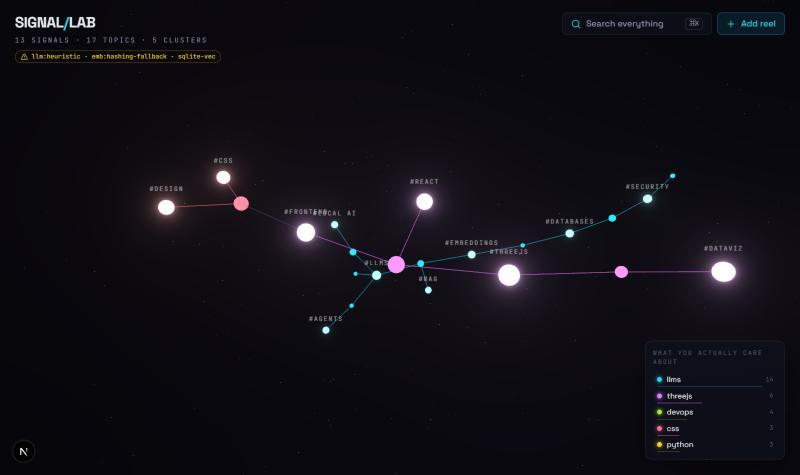
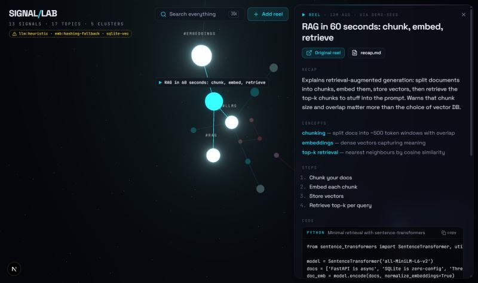
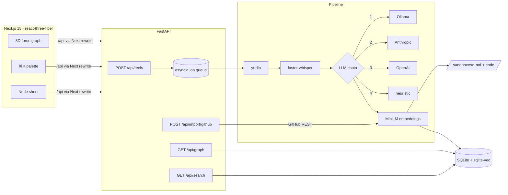

# SignalLab

> **A 3D map of everything you've ever meant to learn — searchable, runnable, and honest about what you actually care about.**

Paste a tech reel from Instagram → it gets downloaded, transcribed, and distilled by a **local LLM** into a one‑page recap with concepts, steps, links and runnable code. Every reel — plus your **GitHub stars** and **reading list** — becomes a node in an interactive **3D force‑directed knowledge graph**, wired together by semantic similarity. The clusters that emerge are your real interests, not the ones you think you have.




<!-- TODO: replace with a GIF of add-reel → processing → node appears → click → sheet -->
> 🎬 _Demo GIF coming soon._

---

## Features (MVP)

| | |
|---|---|
| **Reel ingest** | `yt-dlp` download → `faster-whisper` transcription (VAD drops music) → LLM extraction of `{title, summary, concepts, code_snippets, steps, links, topics}` → embeddings → SQLite |
| **Local-first LLM** | Ollama (`llama3.1:8b` / `qwen2.5:7b`) by default. Auto-detected at startup; falls back to Anthropic → OpenAI → a keyword heuristic, so an ingest never dies because a model is down |
| **Sandbox** | Each reel writes `data/sandboxes/<id>/README.md` (the recap) + `snippet_N.<ext>` files you can run |
| **Knowledge graph** | `all-MiniLM-L6-v2` embeddings, kNN cosine edges above a threshold, reel→topic edges, label-propagation clusters |
| **3D UI** | react-three-fiber + d3-force-3d, instanced rendering, bloom glow, neighbourhood highlighting, camera fly-to |
| **GitHub stars** | Import any user's public stars; they attach to the topics your reels created |
| **Reading list** | URL + note + tags → node |
| **Search** | ⌘K command palette, semantic search across everything (sqlite-vec KNN) |
| **Deep links** | `/node/<id>` opens the side sheet over the graph |

## Architecture



```
reel URL ──► yt-dlp ──► audio ──► Whisper ──► transcript ─┐
                │                                         ├─► LLM ──► extraction ──► embed ──► SQLite (+vec)
                └──────────────► caption ─────────────────┘                    └──► sandbox/<id>/
GitHub stars ─► description+topics ─► embed ─┐
reading list ─► title+note+tags ────► embed ─┴──► kNN edges + topic edges ──► clusters ──► /api/graph ──► 3D
```

## Quick start (3 commands)

Prereqs: **Python 3.11+**, **Node 20+**, and **[Ollama](https://ollama.com/download)** (optional but recommended).

**Windows (PowerShell)**
```powershell
ollama pull llama3.1:8b
.\scripts\setup.ps1
.\scripts\dev.ps1
```

**macOS / Linux**
```bash
ollama pull llama3.1:8b
./scripts/setup.sh
./scripts/dev.sh
```

Open **http://localhost:3000** (API docs at http://localhost:8000/docs).

> First reel is slow: Whisper `small` (~460 MB) and MiniLM (~90 MB) download on first use.

### Want to see it before installing Ollama?

```bash
cd backend
.venv/bin/python -m signallab.seed                      # Windows: .venv\Scripts\python -m signallab.seed
.venv/bin/python -m signallab.seed --github <username>  # also pull someone's stars
```

Seeds six demo reels (canned extractions) and a small reading list so the graph has something in it.

## Manual setup

<details>
<summary>Step by step</summary>

1. **Ollama** — install from https://ollama.com/download, then:
   ```bash
   ollama pull llama3.1:8b   # or: ollama pull qwen2.5:7b  (then set OLLAMA_MODEL)
   ```
2. **Config** — `cp .env.example .env` and tweak if needed. Everything has a sane default.
3. **Backend**
   ```bash
   cd backend
   python -m venv .venv
   .venv/bin/pip install -r requirements.txt     # Windows: .venv\Scripts\pip ...
   .venv/bin/uvicorn signallab.main:app --reload --port 8000
   ```
4. **Frontend**
   ```bash
   cd frontend
   npm install
   npm run dev
   ```
</details>

### Instagram needs cookies

Instagram increasingly requires a logged-in session even for public reels. If you see _"Instagram wants a logged-in session"_, set one of:

```ini
YTDLP_COOKIES_FROM_BROWSER=chrome   # or firefox / edge / brave
YTDLP_COOKIES_FILE=/path/to/cookies.txt
```

## Docker (nice-to-have)

```bash
docker compose up --build
docker compose exec ollama ollama pull llama3.1:8b
```

UI on :3000, API on :8000, Ollama on :11434. Data, model weights and Ollama models live in named volumes.
_Untested on a clean machine yet — the local scripts are the supported path._

## Configuration

All variables are optional; see [`.env.example`](.env.example) for the full list with comments.

| Variable | Default | |
|---|---|---|
| `LLM_PROVIDER` | `auto` | `auto` · `ollama` · `anthropic` · `openai` · `heuristic` |
| `OLLAMA_MODEL` | `llama3.1:8b` | any model you've pulled |
| `ANTHROPIC_API_KEY` / `OPENAI_API_KEY` | — | cloud fallback if Ollama is unreachable |
| `WHISPER_MODEL` | `small` | `tiny` → `large-v3` |
| `WHISPER_DEVICE` | `cpu` | `cuda` if you have a GPU |
| `GRAPH_SIMILARITY_THRESHOLD` | `0.45` | raise for a sparser graph |
| `GITHUB_TOKEN` | — | lifts the 60 req/h unauthenticated limit |

## API

| Method | Path | |
|---|---|---|
| `POST` | `/api/reels` | `{url}` → 202, enqueues. Dedupes by shortcode; re-queues failed ones |
| `GET` | `/api/reels` · `/api/jobs` | all reels · in-flight + recent failures |
| `GET` | `/api/reels/{id}` · `/api/nodes/{id}` | detail incl. extraction, transcript, related nodes |
| `GET` | `/api/nodes/{id}/recap.md` | the one-page recap as Markdown |
| `POST` | `/api/reels/{id}/retry` | re-run a failed reel |
| `DELETE` | `/api/nodes/{id}` | remove (prunes orphan topics) |
| `GET` | `/api/graph?threshold=&max_neighbors=` | nodes, links, clusters |
| `GET` | `/api/search?q=&k=` | semantic search |
| `POST` | `/api/import/github` | `{username}` |
| `POST` | `/api/import/reading` | `{items: [{url, title, note, tags}]}` |
| `GET` | `/api/health` | which LLM / embedder / vector index is active |

## Error handling

| Situation | What happens |
|---|---|
| Private reel / login wall | Job fails with `private_or_login_required` + a hint to set cookies; one-click retry |
| Rate limited / 404 | Distinct codes (`rate_limited`, `not_found`) with hints |
| Music-only audio | VAD yields ~no words → falls back to the caption. No caption either → `no_speech` |
| Ollama down | Detected at startup; each call also walks the chain (Ollama → Anthropic → OpenAI → heuristic). Heuristic nodes are flagged **degraded** in the UI |
| LLM returns junk | Tolerant JSON parsing (fences, chatter, trailing commas, loose shapes) + one retry |
| sentence-transformers / sqlite-vec missing | Falls back to hashing embeddings / numpy search, and the UI badge says so |
| Backend restart mid-job | Unfinished jobs are re-enqueued from SQLite on startup |

## Tests

```bash
cd backend
pip install -r requirements-dev.txt     # lightweight: no torch / whisper needed
pytest -q
```

42 tests cover the ingestion pipeline (yt-dlp, Whisper and the LLM are mocked), LLM output parsing, provider fallback detection, graph building/clustering, sqlite-vec ↔ numpy parity, and the HTTP API end to end. CI runs them plus a frontend lint + build.

## Project layout

```
backend/
  signallab/
    main.py          FastAPI app + routes
    pipeline.py      ingest orchestration (reels, stars, reading)
    worker.py        asyncio job queue
    graph.py         kNN edges + label-propagation clusters
    db.py            SQLite + sqlite-vec store
    sandbox.py       recap.md + snippet files
    seed.py          demo data
    services/        downloader · transcriber · llm · embedder · github
  tests/
frontend/
  src/app/(graph)/   shared graph layout, / and /node/[id]
  src/components/    graph/ · hud/ · node/ · ui/ (shadcn-style)
scripts/             setup + dev for PowerShell and bash
```

## Status & roadmap

This is an MVP. Working end-to-end: ingest pipeline, fallbacks, graph, clusters, search, GitHub/reading import, node sheet, deep links. Stubbed / next:

- [ ] **Run code in-browser** — snippets are written to disk as a sandbox, but there's no "▶ Run" button yet (Pyodide / WebContainers)
- [ ] **Reading list ingestion** — fetch + summarise the page instead of embedding just title/note/tags
- [ ] **Time slider** — `created_at` / `starred_at` are stored; the UI doesn't yet animate clusters over time
- [ ] Syntax highlighting (shiki), cluster naming via LLM, batch reel import
- [ ] Auth / multi-user — deliberately out of scope (single-user, local)

## Why I built this

I save a ridiculous number of tech reels, star repos I never open again, and keep a reading list that only grows. It all feels like learning, but it's really just hoarding — and none of it talks to each other. SignalLab is my attempt to turn that pile into something I can actually use: every saved thing becomes a searchable recap with the code pulled out, and the 3D map shows me, without flattery, which topics I keep coming back to and which ones were just a passing scroll. It's also a chance to wire together the parts of the stack I care about — local LLMs, embeddings, and real-time 3D on the web — in one project that runs entirely on my own machine.

## License

MIT
