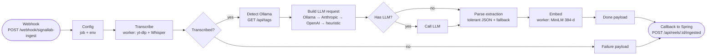

# n8n — the ingest pipeline

The reel pipeline runs as an n8n workflow, **"SignalLab · Ingest reel"** ([`workflows/ingest-reel.json`](workflows/ingest-reel.json)). Spring only orchestrates *around* it: it validates the URL, mints a one-time callback token, triggers the webhook, and waits for the callback (with a timeout sweeper as the backstop).



## How it's loaded

`infra/n8n-entrypoint.sh` runs on every container start:

```sh
n8n import:workflow --input=/workflows/ingest-reel.json
n8n publish:workflow --id=SignalLabIngest1
exec n8n start
```

So the JSON in this folder is the source of truth. To iterate in the editor instead, set `SIGNALLAB_IMPORT_WORKFLOWS=false` in `.env`, restart n8n, edit at http://localhost:5678 (first visit asks you to create an owner account), then export it back:

```bash
docker compose exec n8n n8n export:workflow --id=SignalLabIngest1 --output=/tmp/wf.json
docker compose cp n8n:/tmp/wf.json n8n/workflows/ingest-reel.json
```

## Contract

**Spring → n8n** (webhook, answered immediately):

```json
{ "reelId": "uuid", "url": "https://www.instagram.com/reel/…/",
  "callbackUrl": "http://backend:8080/api/reels/<id>/ingested",
  "callbackToken": "<one-time random token>" }
```

**n8n → Spring** (`POST callbackUrl`, header `X-Ingest-Token: <callbackToken>`):

```json
{
  "status": "done",
  "provider": "ollama", "model": "llama3.1:8b", "degraded": false,
  "title": "…", "caption": "…", "uploader": "…", "duration": 31.0, "language": "en",
  "transcript": "…", "noSpeech": false,
  "extraction": {
    "title": "…", "summary": "…",
    "concepts": [{ "name": "…", "explanation": "…" }],
    "codeSnippets": [{ "language": "python", "code": "…", "description": "…" }],
    "steps": ["…"], "links": [{ "url": "https://…", "label": "…" }],
    "topics": ["llms", "rag"]
  },
  "embedding": [/* 384 floats, unit-normalised */],
  "embeddingModel": "sentence-transformers/all-MiniLM-L6-v2"
}
```

or, on failure:

```json
{ "status": "failed", "error": { "code": "private_or_login_required", "message": "…", "detail": "…" } }
```

The token is stored hashed and cleared once the reel reaches a terminal state, so replayed or late callbacks get `403`. Jobs whose callback never arrives are failed after `INGEST_TIMEOUT` (default 20 min).

## LLM provider detection

`Build LLM request` picks, in order (override with `LLM_PROVIDER`):

1. **Ollama** — if `GET $OLLAMA_URL/api/tags` answers *and* `$OLLAMA_MODEL` is pulled
2. **Anthropic** — if `ANTHROPIC_API_KEY` is set
3. **OpenAI** — if `OPENAI_API_KEY` is set
4. **Heuristic** — keyword extraction; the node is flagged `degraded` and the UI says so

If the chosen provider errors or returns unparseable output, `Parse extraction` falls back to the heuristic rather than failing the job. API keys are only read inside HTTP-node header expressions (`$env.…`), so they never appear in item data or execution logs.

## The media worker (`python-nodes/`)

The yt-dlp / faster-whisper / sentence-transformers code from the original Python prototype lives here as a small FastAPI service the workflow calls over HTTP:

| Endpoint | |
|---|---|
| `POST /transcribe {url}` | download + transcribe; returns `{ok: true, transcript, caption, …}` or `{ok: false, error: {code, message, detail}}` (private reel, 404, rate limit, music-only…) |
| `POST /embed {texts}` | `{model, dim: 384, vectors}` — also used by the Spring backend for search queries and GitHub stars |
| `GET /health` | |

**Why HTTP instead of Execute Command nodes?** The official n8n image is Alpine-based and n8n 2.x disables Execute Command by default; faster-whisper (CTranslate2) and PyTorch don't ship musl wheels. A sidecar keeps the n8n image stock and the ML deps in a normal Debian Python image. If you run a Debian-based n8n with these deps installed, `python -m signallab_worker.cli transcribe <url>` prints the same JSON for an Execute Command node.
